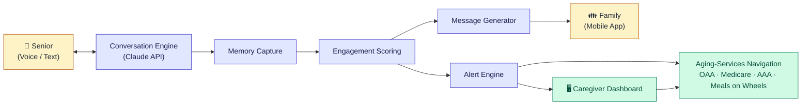

# Access For Seniors

<!-- BEGIN DISCLAIMER: synced from dougdevitre/access-to, edit it there -->
> [!IMPORTANT]
> **Educational information only.** Access for Seniors is not legal, medical, mental health, financial or safety advice, and using it creates no professional relationship. **In danger now? Call 911. For crisis support, call or text 988.** Confirm anything important with the official source or a licensed professional. Read the full [disclaimer](DISCLAIMER.md).
<!-- END DISCLAIMER -->

> AI-powered platform for senior connection, loneliness mitigation, and aging-services navigation.
> Part of **[Access To](https://dougdevitre.org)** — open-source tools for the access gaps that matter most. [See all projects →](https://dougdevitre.org/about.html#pillars)

Access For Seniors helps senior living communities, home health agencies, health systems, and AAAs detect isolation early, keep families connected, and route older adults to the programs and benefits they've earned.

## Contents

- [The Access To Family](#the-access-to-family)
- [What It Does](#what-it-does)
- [Architecture](#architecture)
- [Tech Stack](#tech-stack)
- [28 Modules](#28-modules)
- [Who It Serves](#who-it-serves)
- [Use as a Claude Skill](#use-as-a-claude-skill)
- [Quick Start](#quick-start)
- [Security & Compliance](#security--compliance)
- [Brand Voice](#brand-voice)
- [Contributing](#contributing)
- [Contact](#contact)
- [License](#license)

## The Access To Family

| Project | Focus |
|---------|-------|
| Access To Health | Public health, SDOH, APHA-grounded |
| Access To Jobs | Workforce, WIOA-grounded |
| Access To Housing | Fair Housing-compliant housing navigation |
| Access To Education | Special-needs advocacy, IEP, educational equity |
| Access To Safety | Trauma-informed safety planning |
| Access To Services | SDOH intake, social services navigation |
| Access To Peace | Mediation, AFCC/ABA standards |
| Access To Business | Startup/entrepreneurship support |
| **Access For Seniors** | **Senior connection + aging services navigation** |

**Shared values:** Equity, trauma-informed design, community-grounded, evidence-based, plain language.

## What It Does

- **AI Companion** — Memory-aware conversations with seniors via text and voice (Anthropic Claude)
- **Engagement Signals** — Multi-signal detection of reduced social connection (not diagnoses — connection signals)
- **Caregiver Dashboard** — Real-time alerts, resident profiles, shift notes, and reporting
- **Family Outreach** — AI-generated, warm, personalized messages that encourage family connection
- **Aging-Services Navigation** — Match needs to OAA, Medicare, Medicaid, AAA, Meals on Wheels, caregiver respite
- **Multi-Tenant SaaS** — Single facilities, multi-site orgs, and health system enterprises

## Architecture



## Tech Stack

| Layer | Technology |
|-------|-----------|
| Frontend | React 18, Vite, TypeScript, Tailwind CSS |
| Mobile | React Native + Expo |
| Auth | Clerk (staff/consumer) + Amazon Cognito (enterprise SSO/SAML) |
| Backend | Node.js + Express (TypeScript), AWS Lambda |
| AI/LLM | Anthropic Claude API |
| Voice | Twilio Voice + ElevenLabs STT/TTS |
| Database | DynamoDB (primary) + RDS Aurora (analytics) |
| Storage | S3 (audio, exports, assets) |
| Billing | Stripe (subscriptions, metering) |
| Infrastructure | AWS CDK (TypeScript), GitHub Actions CI/CD |
| MCP | Custom MCP server (7 tool schemas) |

## 28 Modules

| # | Module | # | Module | # | Module |
|---|--------|---|--------|---|--------|
| 1 | Resident Onboarding | 11 | Notifications | 21 | Enterprise Admin Portal |
| 2 | AI Conversation Core | 12 | Analytics & Reporting | 22 | API & MCP Tools |
| 3 | Memory & Context | 13 | Multi-Tenant Core | 23 | Integrations Hub |
| 4 | Engagement Scoring | 14 | Auth & SSO | 24 | Research & Outcomes |
| 5 | Alert Engine | 15 | Billing & Subscriptions | 25 | Training & Certification |
| 6 | Caregiver Dashboard | 16 | AWS Infrastructure | 26 | Family Portal (Web) |
| 7 | Family Mobile App | 17 | CI/CD | 27 | Predictive Wellness |
| 8 | Voice Interface | 18 | Security & Compliance | **28** | **Aging-Services Navigation** |
| 9 | Family Outreach | 19 | Data Export & Portability | | |
| 10 | Community Features | 20 | White-Label Config | | |

## Who It Serves

| Role | Primary Interface | Key Need |
|------|-------------------|----------|
| Senior / Resident | Voice + Mobile | Natural, low-friction conversation and service connection |
| Family Member | Mobile + Web | Peace of mind, connection reminders, coordination |
| Caregiver / Staff | Dashboard | Alerts, notes, resident context, resource referrals |
| Facility Admin | Admin Portal | Tenant config, billing, reporting |
| Enterprise Operator | API + Admin | Multi-site management, analytics |
| AAA / Community Worker | Navigator Portal | Referral tracking, eligibility screening |

## Use as a Claude Skill

Add Access for Seniors to Claude at [claude.ai](https://claude.ai) in a few clicks. It works on the Free, Pro, Max, Team and Enterprise plans.

1. **Download the install file:** [access-for-seniors.zip](https://github.com/dougdevitre/access-for-seniors/releases/download/skill-latest/access-for-seniors.zip)
2. **Don't unzip it.** Claude needs the `.zip` file just as it downloaded.
3. **Turn on code execution.** Skills need it.
   - **Free, Pro or Max:** open **Settings > Capabilities** and turn on **Code execution and file creation**.
   - **Team or Enterprise:** an organization owner opens **Organization settings > Plugins & skills**, clicks the **Policy** tab, and turns on both **Code execution and file creation** and **Skills**.
4. **Upload it:** open **Customize > Skills**, click **+**, then **+ Create skill**, then **Upload a skill**, and choose `access-for-seniors.zip`.
5. **Turn it on:** in **Customize > Skills**, switch on **access-for-seniors**. Claude will now use it for any Access for Seniors question.

These steps come from Claude's help center: [Use Skills in Claude](https://support.claude.com/en/articles/12512180-use-skills-in-claude).
If the link 404s, the first release hasn't been published yet.

Maintainers and forks: `scripts/build-skill-zip.sh` builds the same file into `dist/`. The Skill package workflow republishes it on every change to `main`.

The repo layout (the zip holds `SKILL.md`, `references/`, `DISCLAIMER.md` and `LICENSE.md`):

```
access-for-seniors/
├── SKILL.md                          ← Skill entry point
├── references/                       ← Loaded on demand by topic
│   ├── modules.md                    ← All 28 module specs
│   ├── data-models.md                ← DynamoDB + RDS schemas
│   ├── security.md                   ← HIPAA controls, RBAC, consent
│   ├── conversation-engine.md        ← LLM orchestration, prompts, safety
│   ├── engagement-scoring.md         ← Connection signal algorithm
│   ├── aging-services.md             ← OAA, Medicare, AAA, Meals on Wheels
│   ├── mcp-tools.md                  ← MCP server tool schemas
│   ├── auth.md                       ← Clerk + Cognito setup
│   ├── billing.md                    ← Stripe integration
│   ├── multi-tenant.md               ← Tenant isolation architecture
│   ├── aws-deployment.md             ← CDK stacks, IAM, environments
│   ├── cicd.md                       ← GitHub Actions pipeline
│   ├── mobile-app.md                 ← React Native / Expo
│   ├── gtm.md                        ← Positioning, ICP, messaging
│   └── [9 more reference files]
├── docs/                             ← Guides and onboarding
├── tests/                            ← Skill validation tests
└── scripts/                          ← Build and packaging scripts
```

## Quick Start

```bash
git clone https://github.com/dougdevitre/access-for-seniors.git
cd access-for-seniors
./scripts/validate.sh          # verify the skill is structurally valid
./scripts/build-skill.sh       # build dist/access-for-seniors.skill
```

Then:

- **As a Claude skill:** follow [Use as a Claude Skill](#use-as-a-claude-skill)
- **For development:** see [`docs/installation.md`](docs/installation.md) and [`docs/quick-start.md`](docs/quick-start.md)
- **Contributor architecture overview:** [`docs/architecture.md`](docs/architecture.md)
- **Domain glossary (OAA, AAA, HCBS, etc.):** [`docs/glossary.md`](docs/glossary.md)

## Security & Compliance

- HIPAA-aligned defaults (encryption, audit logging, tenant isolation, BAAs)
- Engagement scores are **connection signals**, not clinical diagnoses
- Consent-first: AI features require explicit resident/guardian consent
- Role-based access control across 6 roles (Resident, Family, Caregiver, Admin, Operator, AAA/Community Worker)
- Elder abuse mandatory reporting support (state-dependent)
- See [`references/security.md`](references/security.md) for full controls

## Brand Voice

Calm, professional, empathetic. Practical over poetic. No hype. No fear-based messaging. Person-first language ("older adult" not "elderly"). Plain over bureaucratic ("help with meals" not "Title III-C nutrition services" — unless the program uses that term).

## Contributing

See [`CONTRIBUTING.md`](CONTRIBUTING.md). PRs welcome — please run `./scripts/validate.sh` before opening one. Issue and pull request templates live under `.github/`.

## Contact

Doug Devitre — [dougdevitre@gmail.com](mailto:dougdevitre@gmail.com) — [cotrackpro.com](https://cotrackpro.com)

## License

MIT — see [LICENSE](LICENSE.md). Part of the open-source Access To initiative.
