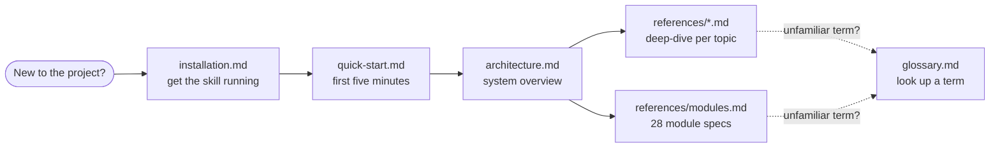

# Access For Seniors — Docs

This folder is for humans working **on** or **with** the skill. The skill runtime itself only ships `SKILL.md` + `references/`.

## Start here

| If you want to… | Read |
|---|---|
| Install the skill in Claude | [`installation.md`](installation.md) |
| Try it out in five minutes | [`quick-start.md`](quick-start.md) |
| Understand how the pieces fit together | [`architecture.md`](architecture.md) |
| Look up a term (OAA, AAA, HCBS, BAA…) | [`glossary.md`](glossary.md) |
| Contribute changes | [`../CONTRIBUTING.md`](../CONTRIBUTING.md) |
| Report a security issue | [`../SECURITY.md`](../SECURITY.md) |
| Propose a new module or reference file | Use an issue template in [`../.github/ISSUE_TEMPLATE/`](../.github/ISSUE_TEMPLATE/) |

## Reading map

## Tips

- **Don't edit the `.skill` file by hand.** Edit `SKILL.md` or `references/*.md` and run `./scripts/build-skill.sh` to repackage.
- **Run `./scripts/validate.sh` after any edit** to `SKILL.md` or `references/`. CI does this on every PR but local feedback is faster.
- **Run `./tests/content-checks.sh`** to confirm documented invariants (module count, retention defaults, MCP tool surface) still hold.
- **Reference files load on demand.** Ask Claude about a specific topic; don't try to make it "load everything."
