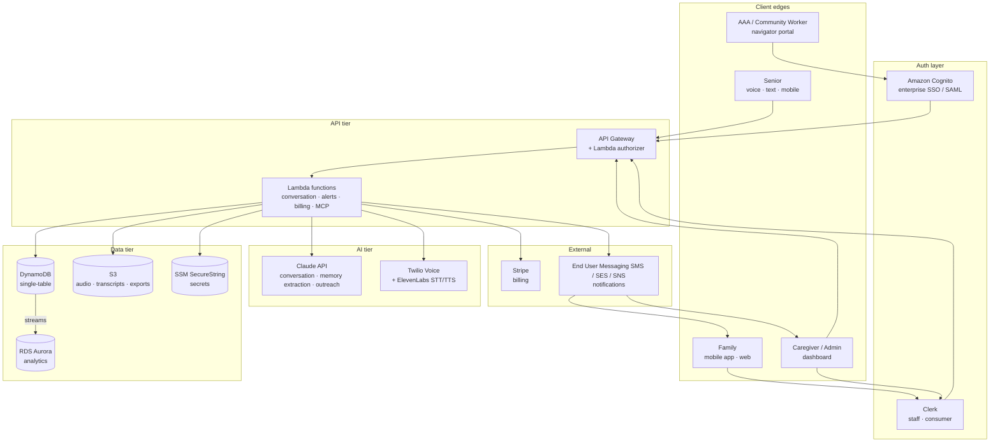
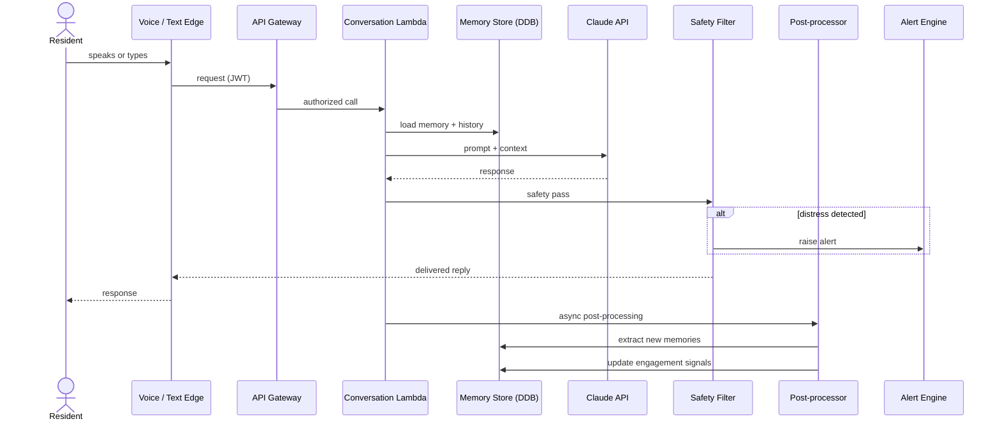
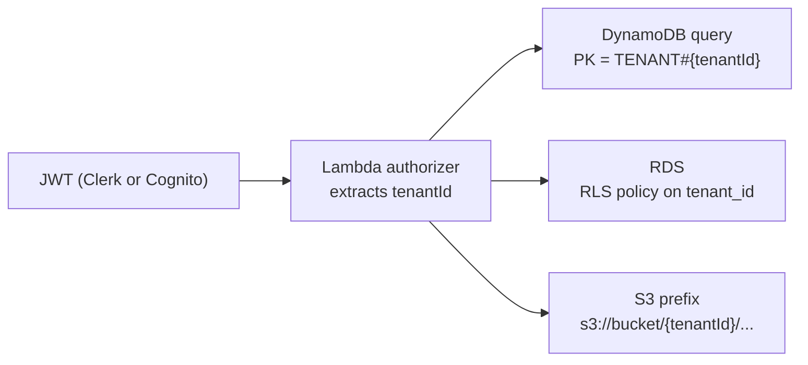
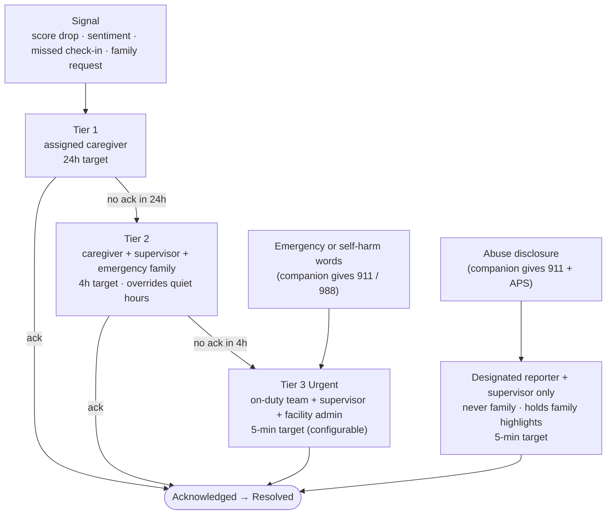

# Architecture Overview

A contributor-facing map of how Access For Seniors fits together. For detailed specs on any subsystem, see the [reference files](../references/).

## System at a glance

## Request path: a resident conversation

## Tenant isolation

Every downstream call carries the resolved `tenantId`. Middleware rejects any request whose resource tenant disagrees with the token claim. See [`multi-tenant.md`](../references/multi-tenant.md) and [`security.md`](../references/security.md).

## Alert escalation

## Module ↔ reference file map

| Layer | Modules | Key reference files |
|-------|---------|---------------------|
| Engagement | 2, 3, 4 | `conversation-engine.md`, `memory-capture.md`, `engagement-scoring.md` |
| Outreach | 5, 9, 11 | `alerts-system.md`, `family-outreach.md`, `message-generator.md`, `notifications.md` |
| Surfaces | 6, 7, 26, 8, 10 | `caregiver-dashboard.md`, `mobile-app.md`, `voice-interface.md`, `community-features.md` |
| Platform | 13, 14, 15, 16, 17, 18 | `multi-tenant.md`, `auth.md`, `billing.md`, `aws-deployment.md`, `cicd.md`, `security.md` |
| Data & APIs | 12, 19, 22 | `data-models.md`, `analytics.md`, `mcp-tools.md` |
| Navigation | 28 | `aging-services.md` |

## Where to start if you're…

- **New engineer:** read this file, then `references/data-models.md`, then the reference(s) for the module you're working on.
- **Designing a feature:** follow §4 "Core Workflows" in [`SKILL.md`](../SKILL.md).
- **Doing security review:** start at [`references/security.md`](../references/security.md), then [`references/multi-tenant.md`](../references/multi-tenant.md).
- **Writing outreach copy:** [`references/family-outreach.md`](../references/family-outreach.md) + [`references/gtm.md`](../references/gtm.md) for voice.
- **Researching a program:** [`references/aging-services.md`](../references/aging-services.md) + [glossary](glossary.md).
