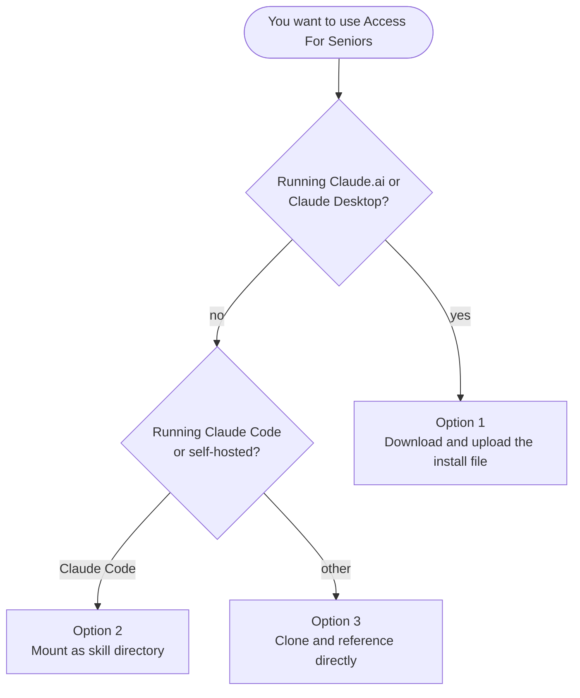

# Installation Guide

## Prerequisites

- **Bash** and **zip** (for build and validation scripts)
- **git** (if cloning)
- A Claude surface that supports skills: Claude.ai, Claude Desktop, or Claude Code

## Which option should I pick?



## Option 1: Install in Claude (download the install file)

1. Download [`access-for-seniors.zip`](https://github.com/dougdevitre/access-for-seniors/releases/download/skill-latest/access-for-seniors.zip). Don't unzip it.
2. Turn on **Code execution and file creation** under Settings → Capabilities (Free, Pro and Max plans; on Team it's on by default; on Enterprise an owner enables it).
3. Go to **Customize → Skills**, click **+**, then **+ Create skill**, then **Upload a skill**.
4. Choose `access-for-seniors.zip`, then make sure the skill is toggled on.

These steps follow Claude's help center: [Use skills in Claude](https://support.claude.com/en/articles/12512180-use-skills-in-claude). The install file is rebuilt automatically whenever the skill changes on `main`.

### Build the install file yourself (optional)

```bash
bash scripts/build-skill-zip.sh
```

This creates `dist/access-for-seniors.zip`, the same file the release publishes. The older `./scripts/build-skill.sh` still builds `dist/access-for-seniors.skill` for anyone who uses it.

## Option 2: Install as a local skill directory

If you're running Claude Code or have a skill directory mounted:

```bash
# Copy SKILL.md + references/ to your skill directory
mkdir -p /path/to/your/skills/access-for-seniors
cp SKILL.md /path/to/your/skills/access-for-seniors/
cp -r references /path/to/your/skills/access-for-seniors/

# The directory must contain SKILL.md at the root
```

## Option 3: Use directly from GitHub

Clone the repo and reference it from your Claude environment:

```bash
git clone https://github.com/dougdevitre/access-for-seniors.git
cd access-for-seniors
./scripts/validate.sh
```

## Verifying the installation

Ask Claude something like:

- "What are the 28 modules in Access For Seniors?"
- "Show me the DynamoDB schema for Access For Seniors residents"
- "Design a feature for Access For Seniors Module 5 Alert Engine"

If the skill is working, Claude will reference the Access For Seniors architecture and modules rather than answering generically. See [`tests/manual-tests.md`](../tests/manual-tests.md) for the full verification set.

## Troubleshooting

### Skill doesn't trigger

- Verify `SKILL.md` frontmatter is valid YAML (opens and closes with `---` on their own lines).
- Confirm the `description` field mentions "Access For Seniors" and at least one trigger phrase.
- Run `./scripts/validate.sh` — if it exits non-zero, fix those errors first.
- Try one of the explicit trigger prompts from `tests/manual-tests.md` — a vague prompt ("help with seniors") won't activate the skill.

### Reference files not loading

- Reference files load **on demand**, not at skill startup. Ask about a specific topic (e.g., "how does engagement scoring work?") to trigger the right one.
- The `SKILL.md` table in §7 maps topics → reference files. If your topic isn't listed, the skill won't know which file to load.
- If a reference file is missing, `./scripts/validate.sh` will flag it.

### `./scripts/validate.sh` fails

- `FAIL: references/<file>.md missing` — the file was renamed or deleted but still referenced.
- `FAIL: references/modules.md has N modules, expected 28` — the module list got edited out of sync. Update the module and re-run.
- `FAIL: <file> references '<old-count> modules'` — a rebrand leftover slipped in. Update to the current count.
- `FAIL: Broken reference links` — a `references/*.md` file links to another reference that doesn't exist. Check the path.

### `./scripts/build-skill.sh` fails

- `zip: command not found` — install zip (`sudo apt install zip` or `brew install zip`).
- Output still includes the old committed artifact at the repo root — make sure you pulled after the `.gitignore` update and deleted `access-for-seniors.skill` from your working tree.

### The upload isn't accepted

- Make sure you're uploading `access-for-seniors.zip` itself, not an unzipped folder.
- Claude skill uploads expect a zip with `SKILL.md` at the root of a single top-level directory.
- Rebuild from a clean checkout if the package structure looks off: `rm -rf dist && ./scripts/build-skill.sh`.

### Still stuck

Open an issue using the bug report template and include the output of `./scripts/validate.sh`.
