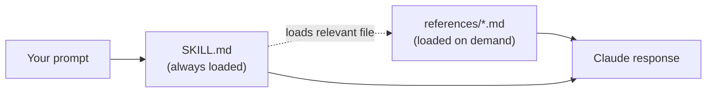

# Quick Start

## What This Skill Does

When installed, this skill guides Claude through any work related to Access For Seniors — a multi-tenant SaaS platform for AI-powered senior connection and loneliness mitigation.

## First five minutes

1. **Install the skill.** See [installation.md](installation.md).
2. **Smoke test.** Ask Claude: *"What is Access For Seniors?"* You should get a description that mentions the 28 modules and the "Access To" family, not a generic answer.
3. **Verify module knowledge.** Ask: *"Name all 28 modules."* Claude should list them from `references/modules.md`.
4. **Try a real task.** Pick an [example prompt](#example-prompts) that matches what you actually need — a spec, an API route, an outreach message, a compliance question.
5. **If something looks off,** run `./scripts/validate.sh`. See the [installation troubleshooting section](installation.md#troubleshooting) if it fails.

## How the skill works (briefly)

`SKILL.md` is always available to Claude. Reference files are only pulled in when you ask about a topic that maps to one (see `SKILL.md` §7 for the mapping). That's why focused prompts work better than vague ones.

## Example Prompts

### Product & Engineering
- "Design a feature for Module 5 Alert Engine that lets caregivers snooze alerts"
- "Write the DynamoDB access pattern for listing alerts by severity across a tenant"
- "Draft an API endpoint for family members to request a wellness check"
- "What's the data model for the Conversation entity?"
- "Write the TypeScript types for a Resident record"

### Security & Compliance
- "Review this Lambda for HIPAA compliance issues"
- "What consent flags do we need before enabling voice recording?"
- "Design the audit logging strategy for PHI access"

### AI/LLM Work
- "Write the system prompt for the conversation engine"
- "Design the memory extraction prompt for post-conversation processing"
- "How should we handle distress detection in voice calls?"

### Infrastructure
- "Write the CDK stack for the API layer"
- "Design the GitHub Actions deploy workflow for staging"
- "What IAM policy does the conversation Lambda need?"

### Go-to-Market
- "Draft a cold email to an Executive Director at a CCRC"
- "Write positioning copy for the Activities Director persona"
- "What's our differentiation vs. social robots like ElliQ?"

## What to Expect

Claude will:
- Reference specific modules by number (1–28)
- Use the canonical tech stack (React/Vite, Node/TS, DynamoDB, AWS Lambda, Claude API)
- Apply HIPAA-aligned security defaults automatically
- Frame engagement data as "connection signals" not diagnoses
- Follow your output format preferences (spec structure, file tree + code blocks)

## When to Update Reference Files

Update a reference file when:
- You add a new module or change an existing one
- Tech stack components change
- Security or compliance requirements change
- GTM positioning or messaging evolves

After updates, run `./scripts/validate.sh` to confirm the skill structure is intact.

## Where to go next

- **Contributor architecture overview:** [architecture.md](architecture.md)
- **Domain terms (OAA, AAA, HCBS, PHI, …):** [glossary.md](glossary.md)
- **Module specs:** [`references/modules.md`](../references/modules.md)
- **Test prompts to run after edits:** [`tests/manual-tests.md`](../tests/manual-tests.md)
