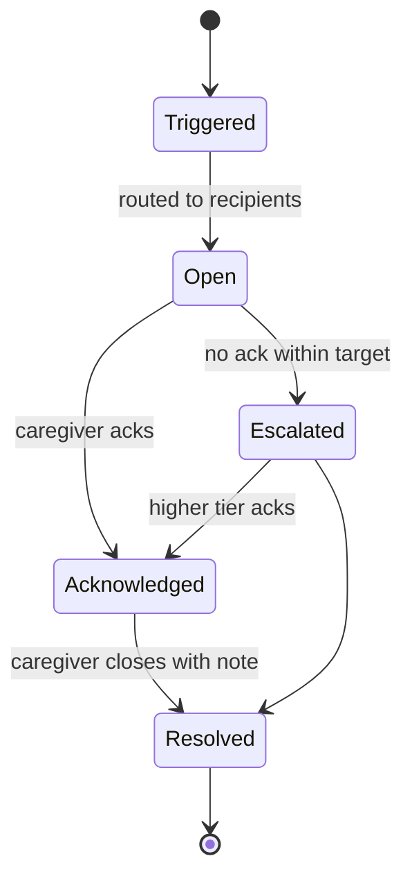

# Access For Seniors — Alerts System

## Alert Types

| Type | Trigger | Default Severity |
|------|---------|-----------------|
| `score_drop` | Engagement score crosses threshold | tier1 (Yellow→Red) or tier2 (sudden drop) |
| `distress_keyword` | Distress detected in conversation | tier2 |
| `missed_checkin` | 3+ consecutive missed scheduled conversations | tier1 |
| `family_request` | Family requests wellness check via app | tier1 |
| `predictive` | Module 27 predicts decline in 7–14 days | tier1 |

## Escalation Tiers

| Tier | Recipients | Response Target | Override Quiet Hours |
|------|-----------|----------------|---------------------|
| Tier 1 | Assigned caregiver(s) | 24 hours | No |
| Tier 2 | Caregiver + supervisor + emergency family | 4 hours | Yes |
| Tier 3 | Facility admin + all family + caregiver team | 1 hour | Yes |

## Alert Lifecycle

## Auto-Escalation

- Tier 1 → Tier 2: if not acknowledged within 24 hours
- Tier 2 → Tier 3: if not acknowledged within 4 hours
- Tier 3: no auto-escalation; admin manually manages
