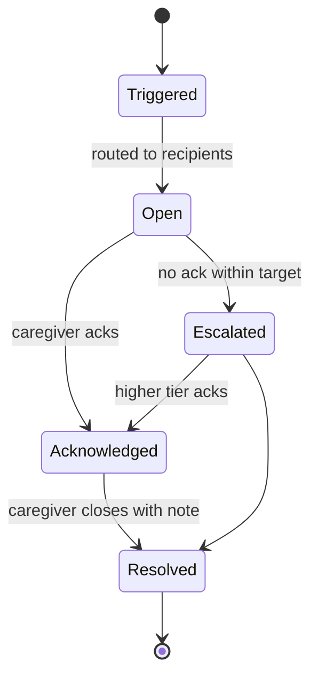

# Access For Seniors — Alerts System

## Alert Types

| Type | Trigger | Default Severity | Routing |
|------|---------|-----------------|---------|
| `emergency_keyword` | Emergency words in conversation ("fell", "can't breathe", "chest pain", "help me") | tier3 | Standard Tier 3 |
| `self_harm_keyword` | Self-harm words ("end it", "no reason to live", "hurt myself") | tier3 | Standard Tier 3 |
| `abuse_disclosure` | Abuse words ("they hit me", "scared of", "won't let me") | tier3 | **Restricted: designated reporter only** (see below) |
| `distress_sentiment` | 3+ negative turns, or a sharp sentiment drop in a session | tier2 | Standard Tier 2 |
| `score_drop` | Engagement score crosses threshold | tier1 (Yellow→Red) or tier2 (sudden drop) | Standard |
| `missed_checkin` | 3+ consecutive missed scheduled conversations | tier1 | Standard |
| `family_request` | Family requests wellness check via app | tier1 | Standard |
| `predictive` | Module 27 predicts decline in 7–14 days | tier1 | Standard |

Keyword groups, example phrases and the companion's reply for each are in
`conversation-engine.md` (Distress Detection and Safety Responses).

## Escalation Tiers

| Tier | Recipients | Response Target | Override Quiet Hours |
|------|-----------|----------------|---------------------|
| Tier 1 | Assigned caregiver(s) | 24 hours | No |
| Tier 2 | Caregiver + supervisor + emergency family | 4 hours | Yes |
| Tier 3 — Urgent | On-duty caregiver team + supervisor/charge nurse + facility admin, all at once; emergency family contact after staff acknowledge | **5 minutes** for emergency, self-harm and abuse alerts (default; configurable per tenant, 2–15 minutes). 1 hour for other Tier 3 alerts (escalated Tier 2, engagement cliff) | Yes |

Tier 3 is for a resident who may need help right now. The companion has
already told the resident to call 911 (or press their call button) or 988, so
the alert brings a person to them; it does not replace 911. Tier 3 alerts use
every channel at once (push, SMS, dashboard badge, and an in-facility page
where configured) rather than the recipient's preferred channel only.

## Restricted Routing: `abuse_disclosure`

The person a resident is afraid of may be a family member, an emergency
contact, or a staff member. So an abuse disclosure never follows the standard
tier recipients.

- **Recipients:** the tenant's designated reporter(s) and the supervisor role
  only. Tenants must name at least two designated reporters, so an alert can
  still reach someone when one of them is the person named.
- **Never sent to** family members, emergency contacts, or the family mobile
  app, at any tier or on escalation. It is not shown in the general caregiver
  alert inbox; only designated reporters and supervisors can see it.
- **Response target:** Tier 3 (5 minutes by default, configurable).
- **Escalation:** if not acknowledged, re-pages the backup designated reporter
  and the supervisor. It never escalates to family.
- **Family outreach hold:** while the alert is open, and until a designated
  reporter clears the hold, the system sends no Conversation Highlight (or
  any other conversation-derived content) to that resident's family. Connection
  Reminders and Milestones may continue, so family see no change that signals
  a report. See `family-outreach.md`.
- **Other alerts from the same conversation:** if a conversation that contains
  an abuse disclosure also raises an emergency or self-harm alert, that alert
  goes to staff only; the emergency family step is skipped and its description
  leaves out the disclosure.
- **Reporting:** the designated reporter decides on and makes any report to
  Adult Protective Services, the Long-Term Care Ombudsman, or law enforcement,
  under state law and facility policy, and records it on the alert. The system
  does not file reports itself. Resolving the alert requires a resolution note.

## Alert Lifecycle

## Auto-Escalation

- Tier 1 → Tier 2: if not acknowledged within 24 hours
- Tier 2 → Tier 3: if not acknowledged within 4 hours. The alert goes to the
  Tier 3 recipients with the 1-hour target; the 5-minute target applies only
  to emergency, self-harm and abuse alerts
- Tier 3: re-pages all Tier 3 staff recipients every response-target interval
  (5 minutes or 1 hour, as above) until a person acknowledges; the facility admin manages
  it from there
- `abuse_disclosure`: re-pages the backup designated reporter and supervisor
  only; never escalates to family
