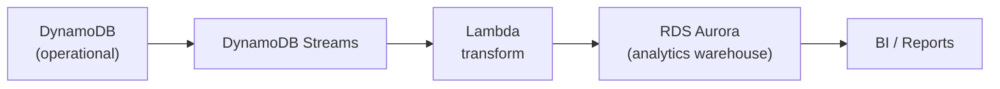

# Access For Seniors — Analytics & Reporting

## Data Pipeline

## Report Types

| Level | Report | Frequency |
|-------|--------|-----------|
| Resident | Engagement trend (30/60/90 day) | On-demand |
| Resident | Conversation summary | Weekly |
| Facility | Aggregate engagement dashboard | Daily |
| Facility | Alert response metrics | Weekly |
| Facility | Family engagement rate | Monthly |
| Enterprise | Cross-facility benchmarking | Monthly |
| Enterprise | ROI report (engagement improvement vs. baseline) | Quarterly |

## Export Formats

- CSV (raw data)
- PDF (formatted report with charts)
- Scheduled delivery via email (SES)
- API endpoint for BI tool integration

## Key Metrics

- Average engagement score (facility-wide)
- % residents in Green / Yellow / Red zones
- Mean time to alert acknowledgment
- Mean time to alert resolution
- Family engagement rate (% of families with weekly contact)
- Conversation frequency (avg per resident per week)
- Resident satisfaction (self-reported, if enabled)
