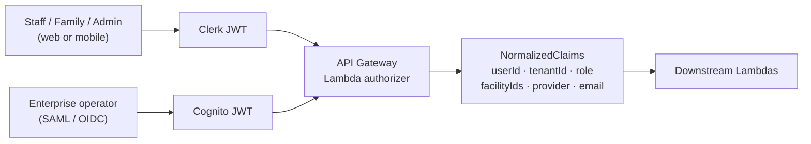

# Access For Seniors — Authentication

## Dual Auth Strategy

Access For Seniors uses two auth providers to serve different user populations:

| Provider | Users | Use Case |
|----------|-------|----------|
| **Clerk** | Caregivers, Family, Facility Admins (web + mobile) | Consumer/staff-facing; fast setup; social login |
| **Amazon Cognito** | Enterprise operators, SAML-federated orgs | Enterprise SSO; SAML 2.0 / OIDC; health system IdPs |

### Why Two Providers
- Clerk provides excellent DX for React/React Native, built-in MFA, social login, and user management UI
- Cognito is required for enterprise customers who mandate SAML federation with their corporate IdP
- JWT claims from both providers are normalized at the API Gateway layer

## Clerk Setup

```typescript
// Frontend — React 18 + Vite
import { ClerkProvider, SignIn, useUser } from '@clerk/clerk-react';

const CLERK_PUBLISHABLE_KEY = import.meta.env.VITE_CLERK_PUBLISHABLE_KEY;

function App() {
  return (
    <ClerkProvider publishableKey={CLERK_PUBLISHABLE_KEY}>
      <RouterProvider router={router} />
    </ClerkProvider>
  );
}
```

### Clerk Roles (via metadata)
```json
{
  "publicMetadata": {
    "role": "caregiver",
    "tenantId": "tenant_abc123",
    "facilityIds": ["fac_001"],
    "permissions": ["read:residents", "write:notes", "manage:alerts"]
  }
}
```

### Mobile — Expo
```typescript
import { ClerkProvider } from '@clerk/clerk-expo';
import * as SecureStore from 'expo-secure-store';

const tokenCache = {
  getToken: (key: string) => SecureStore.getItemAsync(key),
  saveToken: (key: string, value: string) => SecureStore.setItemAsync(key, value),
};
```

## Cognito Setup (Enterprise)

- **User Pool:** One per enterprise tenant (or shared pool with custom attributes)
- **SAML Federation:** Identity provider metadata from customer's IdP (Okta, Azure AD, Ping)
- **Custom attributes:** `custom:tenantId`, `custom:role`, `custom:facilityIds`
- **App client:** Separate clients for web and API access

## JWT Normalization



API Gateway Lambda authorizer normalizes claims from both providers:

```typescript
interface NormalizedClaims {
  userId: string;          // Clerk user_id or Cognito sub
  tenantId: string;        // From metadata/custom attributes
  role: UserRole;          // caregiver | family | admin | operator
  facilityIds: string[];   // Facilities this user can access
  provider: 'clerk' | 'cognito';
  email: string;
}

type UserRole = 'resident' | 'family' | 'caregiver' | 'admin' | 'operator';
```

## Security Requirements

- **MFA:** Required for admin + operator; recommended for caregiver; optional for family
- **Session duration:** 1-hour access token; 30-day refresh token
- **Token validation:** Every Lambda validates JWT signature, expiration, and tenant claim
- **Cross-tenant prevention:** Middleware rejects any request where resource tenantId ≠ token tenantId
