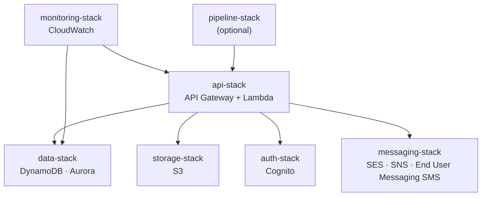

# Access For Seniors — AWS Deployment

## CDK Stack Structure (TypeScript)

```
lib/
├── api-stack.ts          # API Gateway + Lambda functions
├── data-stack.ts         # DynamoDB tables + RDS Aurora cluster
├── auth-stack.ts         # Cognito user pools + identity pools
├── storage-stack.ts      # S3 buckets + lifecycle policies
├── messaging-stack.ts    # SES + SNS + End User Messaging SMS
├── monitoring-stack.ts   # CloudWatch dashboards + alarms
└── pipeline-stack.ts     # CodePipeline (optional; prefer GitHub Actions)
```

### Stack dependencies



Deploy `data-stack`, `storage-stack`, `auth-stack`, and `messaging-stack` before `api-stack` — CDK will refuse to deploy a dependent stack if its prerequisites are not satisfied. `monitoring-stack` and `pipeline-stack` are deployed last.

## Messaging Stack

AWS ends support for Amazon Pinpoint on 2026-10-30. Do not provision Pinpoint
projects, campaigns, journeys or endpoints. Use the successor for each channel:

| Channel | Service | CDK / CloudFormation | SDK (JS v3) |
|---------|---------|----------------------|-------------|
| SMS / voice | AWS End User Messaging SMS | `AWS::SMSVOICE::PhoneNumber`, `AWS::SMSVOICE::Pool`, `AWS::SMSVOICE::OptOutList`, `AWS::SMSVOICE::ConfigurationSet` | `@aws-sdk/client-pinpoint-sms-voice-v2` (`SendTextMessage`) |
| Email | Amazon SES | `aws-cdk-lib/aws-ses` | `@aws-sdk/client-sesv2` |
| Mobile push | Expo Push / APNs / FCM (or SNS mobile push) | `aws-cdk-lib/aws-sns` if SNS is used | `@aws-sdk/client-sns` |

- **IAM:** grant the sending Lambda `sms-voice:SendTextMessage` scoped to the
  phone number or pool ARNs it uses
  (`arn:aws:sms-voice:<region>:<account>:phone-number/<id>`,
  `arn:aws:sms-voice:<region>:<account>:pool/<id>`, plus the configuration set
  ARN if one is passed). No `sms-voice:*`, no `"Resource": "*"`.
- **Opt-outs:** associate an opt-out list with every number or pool and keep
  AWS-managed STOP/HELP handling on unless the app tracks opt-outs itself.
- **Secrets:** Twilio credentials, if Twilio is the SMS fallback, live in SSM
  SecureString and are read at runtime, never in code or CDK context.

## Environments

| Env | AWS Account | Purpose |
|-----|------------|---------|
| dev | Shared dev account | Feature development, integration testing |
| staging | Separate account | Pre-prod validation; mirrors prod config |
| prod | Dedicated account | Production; enhanced monitoring |

## IAM Principles

- Least-privilege per Lambda function
- No wildcard resource policies (`"Resource": "*"` prohibited)
- Service-linked roles for AWS services
- Cross-account access via assume-role (staging → prod deploy)
- Secrets: SSM SecureString; referenced by name, never by value

## DynamoDB Configuration

- On-demand capacity (auto-scaling)
- Point-in-time recovery: enabled (all envs)
- Encryption: AWS-managed KMS key (or customer-managed for enterprise)
- Streams: enabled (for analytics pipeline)
- Global tables: optional for multi-region (enterprise tier)

## S3 Configuration

- Versioning: enabled
- Encryption: SSE-KMS
- Lifecycle: voice recordings → Glacier after 90 days; delete after retention period
- CORS: restricted to app domains
- Block public access: enforced
