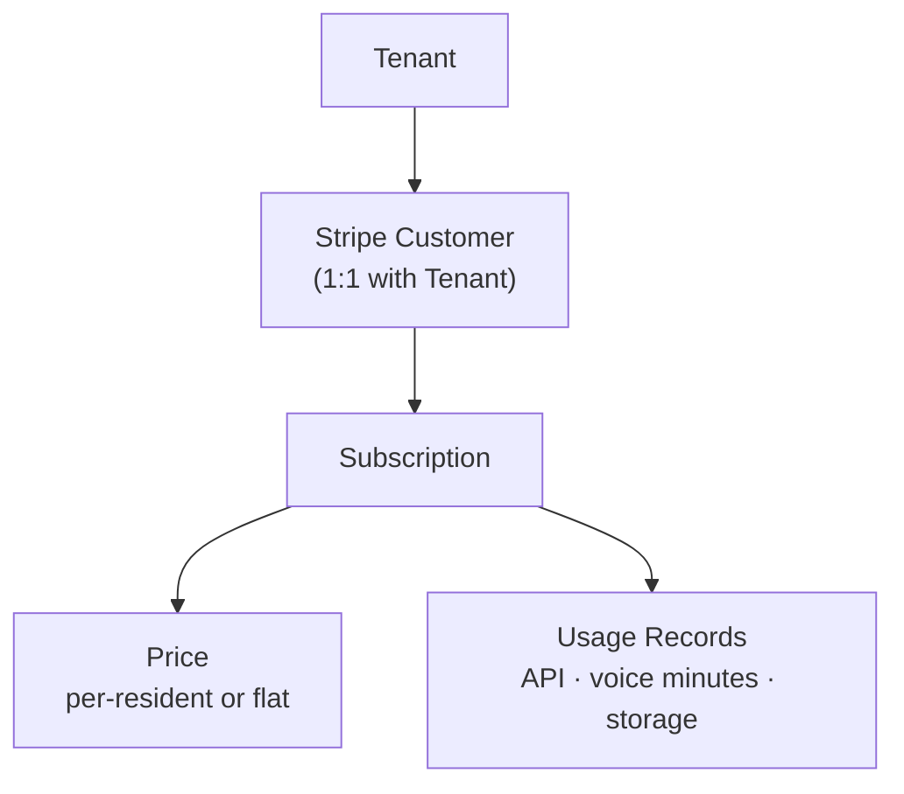

# Access For Seniors — Billing (Stripe)

## Pricing Models

| Model | Target | Structure |
|-------|--------|-----------|
| Per-Resident | Small facilities (10–50 residents) | $X/resident/month, volume tiers |
| Flat Rate | Mid-size facilities (51–200) | $X/facility/month, resident cap |
| Enterprise Custom | Health systems, multi-site orgs | Negotiated; annual contract |

## Stripe Object Mapping

## Webhook Events

| Event | Action |
|-------|--------|
| `invoice.paid` | Update tenant status to active; log payment |
| `invoice.payment_failed` | Start dunning sequence; alert admin |
| `customer.subscription.updated` | Sync plan changes to tenant config |
| `customer.subscription.deleted` | Suspend tenant (grace period: 30 days) |

## Self-Service Portal

- Admin dashboard: view invoices, update payment method, change plan
- Stripe Customer Portal embedded via `billing_portal.sessions.create`
- Restrict plan downgrades that would exceed new resident cap
