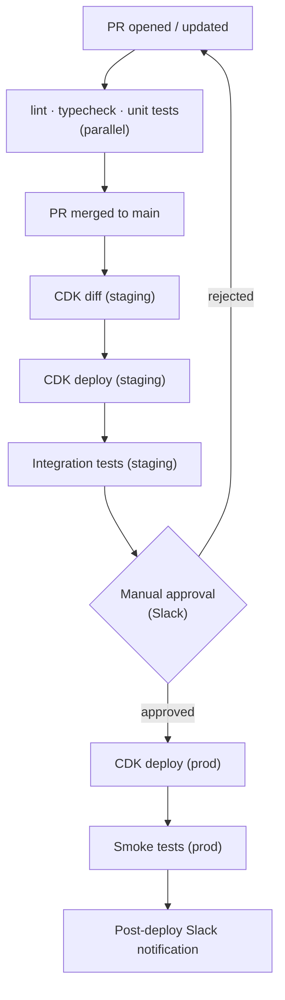

# Access For Seniors — CI/CD

## GitHub Actions Pipeline

## Workflow Files

- `.github/workflows/ci.yml` — lint, typecheck, test on PR
- `.github/workflows/deploy-staging.yml` — deploy to staging on merge to main
- `.github/workflows/deploy-prod.yml` — deploy to prod on manual approval
- `.github/workflows/security-scan.yml` — weekly SAST + dependency audit

## Rollback

- CDK: automatic rollback on CloudFormation failure
- Lambda: versioning + aliases; traffic shift with canary deployment
- Manual rollback: `cdk deploy --previous-version` or Lambda alias update
