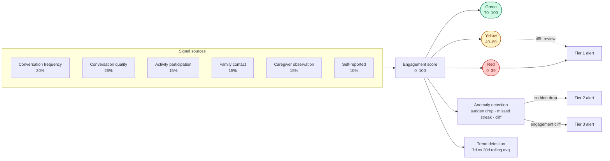

# Access For Seniors — Engagement Scoring

## Philosophy

Loneliness is a subjective emotional experience. Access For Seniors does not diagnose loneliness.
Instead, it measures **engagement signals** — observable behaviors that correlate with social
connection — and surfaces **connection signals** to caregivers and families.

**Language rules:**
- SAY: "reduced engagement", "connection signals", "engagement trend"
- NEVER SAY: "lonely", "isolated", "depressed", "diagnosed", "suffering from"

## How it fits together



## Signal Sources

| Source | Weight | Update Frequency | Collection Method |
|--------|--------|-----------------|-------------------|
| Conversation frequency | 20% | Daily | System log |
| Conversation quality | 25% | Per conversation | Claude analysis (sentiment, depth, topic diversity) |
| Activity participation | 15% | Daily | Staff input / activity module |
| Family contact frequency | 15% | Daily | App usage + call logs |
| Caregiver observations | 15% | Per shift | Dashboard input (structured + free text) |
| Self-reported wellbeing | 10% | Weekly (if enabled) | In-conversation prompt |

## Scoring Algorithm

### Raw Score Calculation (0–100)

```
engagementScore = (
  conversationFrequencyScore * 0.20 +
  conversationQualityScore * 0.25 +
  activityScore * 0.15 +
  familyContactScore * 0.15 +
  caregiverObservationScore * 0.15 +
  selfReportedScore * 0.10
)
```

Each sub-score is normalized to 0–100 based on tenant-configurable baselines.

### Thresholds

| Zone | Score Range | Meaning | Action |
|------|------------|---------|--------|
| Green | 70–100 | Healthy engagement | No action; positive reinforcement |
| Yellow | 40–69 | Reduced engagement | Caregiver review within 48 hours; increase conversation frequency |
| Red | 0–39 | Significantly reduced engagement | Tier 1 alert; caregiver contact within 24 hours |

### Trend Detection

- **7-day rolling average** compared to **30-day rolling average**
- Trend classification:
  - **Improving:** 7-day avg > 30-day avg by ≥5 points
  - **Stable:** Within ±5 points
  - **Declining:** 7-day avg < 30-day avg by ≥5 points
- Declining trend in Yellow zone triggers proactive caregiver notification (even without crossing Red threshold)

### Anomaly Detection

- **Sudden drop:** Score decreases by ≥20 points in 48 hours → immediate Tier 2 alert
- **Missed check-in streak:** 3+ consecutive missed scheduled conversations → Tier 1 alert
- **Engagement cliff:** Score drops from Green to Red in <7 days → Tier 3 alert

## Sub-Score Details

### Conversation Frequency Score
- Baseline: tenant-configurable expected conversations per week (default: 5)
- Score = min(100, (actual / expected) * 100)
- Zero conversations in 72 hours → score drops to 0

### Conversation Quality Score
- Extracted per conversation by Claude (post-conversation analysis):
  - **Depth:** Surface-level (20) → moderate (50) → deep/meaningful (80–100)
  - **Sentiment:** Negative (20) → neutral (50) → positive (80) → joyful (100)
  - **Topic diversity:** Single-topic (40) → multi-topic (70) → exploratory (100)
  - **Engagement cues:** Short responses (30) → moderate (60) → detailed/enthusiastic (100)
- Quality score = weighted average of these four dimensions

### Activity Participation Score
- Based on structured input from Module 10 (Community Features) or caregiver logs
- Score = (activities attended / activities available) * 100, capped at 100
- Bonus: +10 for initiating an activity; +5 for group participation

### Family Contact Score
- Tracks: app logins by family, messages sent, calls made, visits logged
- Score = min(100, (weekly_contacts / expected_weekly_contacts) * 100)
- Expected contacts: tenant-configurable (default: 2/week)

### Caregiver Observation Score
- Structured input: 5-point scale on mood, sociability, appetite, mobility, sleep
- Free text: Claude extracts sentiment and flags
- Score = average of structured ratings * 20

### Self-Reported Wellbeing
- Optional weekly prompt in conversation: "On a scale of 1–5, how connected do you feel this week?"
- Score = self_report * 20
- If resident declines, use 30-day average of prior self-reports; if no history, exclude and reweight

## Ethical Guardrails

1. **No deterministic decisions:** Scores inform human caregivers — they never trigger automated care changes
2. **Transparency:** Caregivers can see all signal sources contributing to a score
3. **Override:** Caregivers can manually adjust a resident's status with documented rationale
4. **Bias monitoring:** Quarterly audit of scores by demographics (age, gender, ethnicity, cognitive status)
5. **No comparison:** Residents are never ranked against each other; scores are individual trajectories
6. **Consent:** Resident can opt out of scoring; status shows "Engagement scoring paused — manual monitoring"
