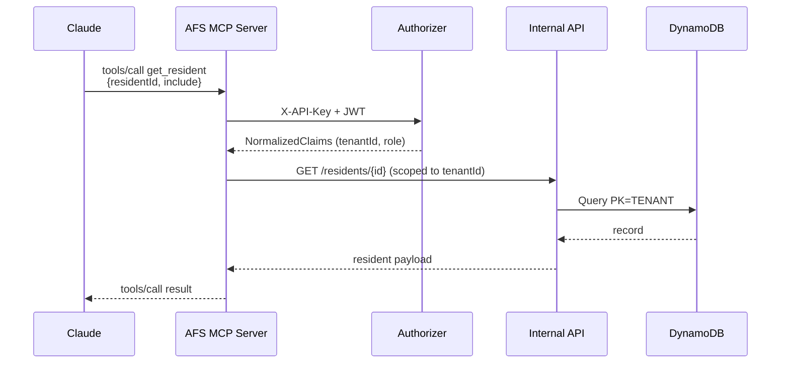

# Access For Seniors — MCP Tools

## Overview

The Access For Seniors MCP server exposes tools that Claude can call when acting as the platform's
AI companion or when integrated into workflows via Claude.ai connectors.

**Server type:** SSE (Server-Sent Events)
**Auth:** API key in header (`X-API-Key`) + tenant context in JWT

## Call sequence



## Tool Schemas

### get_resident
Retrieve resident profile and current engagement data.

```json
{
  "name": "get_resident",
  "description": "Get a resident's profile, interests, engagement score, and recent activity summary.",
  "input_schema": {
    "type": "object",
    "properties": {
      "residentId": { "type": "string", "description": "Resident UUID" },
      "include": {
        "type": "array",
        "items": { "type": "string", "enum": ["profile", "engagement", "memory", "alerts", "family"] },
        "description": "Which data sections to include"
      }
    },
    "required": ["residentId"]
  }
}
```

### log_interaction
Record a conversation or check-in event.

```json
{
  "name": "log_interaction",
  "description": "Log a conversation, check-in, or activity participation event for a resident.",
  "input_schema": {
    "type": "object",
    "properties": {
      "residentId": { "type": "string" },
      "type": { "type": "string", "enum": ["conversation", "checkin", "activity", "family_contact"] },
      "channel": { "type": "string", "enum": ["text", "voice", "mobile", "in_person"] },
      "summary": { "type": "string", "description": "Brief summary of the interaction" },
      "topics": { "type": "array", "items": { "type": "string" } },
      "sentiment": { "type": "string", "enum": ["positive", "neutral", "negative", "mixed"] },
      "durationSeconds": { "type": "number" }
    },
    "required": ["residentId", "type", "channel"]
  }
}
```

### get_engagement_score
Retrieve current engagement score and trend.

```json
{
  "name": "get_engagement_score",
  "description": "Get a resident's current engagement score, trend, and contributing signal breakdown.",
  "input_schema": {
    "type": "object",
    "properties": {
      "residentId": { "type": "string" },
      "includeHistory": { "type": "boolean", "description": "Include 30-day score history" }
    },
    "required": ["residentId"]
  }
}
```

### send_alert
Create and route an alert for a resident.

```json
{
  "name": "send_alert",
  "description": "Trigger an alert for a resident. Routes to appropriate responders based on severity and tenant config. abuse_disclosure alerts go to designated reporters and the supervisor only and never to family or emergency contacts.",
  "input_schema": {
    "type": "object",
    "properties": {
      "residentId": { "type": "string" },
      "type": { "type": "string", "enum": ["emergency_keyword", "self_harm_keyword", "abuse_disclosure", "distress_sentiment", "score_drop", "missed_checkin", "family_request", "predictive"], "description": "abuse_disclosure is always routed to designated reporters and supervisor only, never family" },
      "severity": { "type": "string", "enum": ["tier1", "tier2", "tier3"] },
      "title": { "type": "string" },
      "description": { "type": "string" }
    },
    "required": ["residentId", "type", "severity", "title"]
  }
}
```

### generate_outreach_message
Generate a family outreach message using Claude.

```json
{
  "name": "generate_outreach_message",
  "description": "Generate a warm, personalized outreach message for a resident's family member.",
  "input_schema": {
    "type": "object",
    "properties": {
      "residentId": { "type": "string" },
      "familyMemberId": { "type": "string" },
      "messageType": { "type": "string", "enum": ["connection_reminder", "conversation_highlight", "activity_suggestion", "milestone"] },
      "context": { "type": "string", "description": "Additional context for message generation" }
    },
    "required": ["residentId", "familyMemberId", "messageType"]
  }
}
```

### save_memory
Store a memory item for a resident.

```json
{
  "name": "save_memory",
  "description": "Save a memory item extracted from conversation or caregiver input.",
  "input_schema": {
    "type": "object",
    "properties": {
      "residentId": { "type": "string" },
      "type": { "type": "string", "enum": ["biographical", "preference", "episodic", "relational"] },
      "content": { "type": "string", "description": "The memory content in natural language" },
      "source": { "type": "string", "enum": ["conversation", "caregiver_note", "family_input", "intake"] },
      "confidence": { "type": "number", "minimum": 0, "maximum": 1 }
    },
    "required": ["residentId", "type", "content", "source"]
  }
}
```

### list_residents
List residents for a facility with optional filtering.

```json
{
  "name": "list_residents",
  "description": "List residents for the authenticated tenant, with optional filters.",
  "input_schema": {
    "type": "object",
    "properties": {
      "status": { "type": "string", "enum": ["active", "inactive", "discharged"] },
      "engagementZone": { "type": "string", "enum": ["green", "yellow", "red"] },
      "assignedCaregiver": { "type": "string" },
      "limit": { "type": "number", "default": 25, "maximum": 100 },
      "cursor": { "type": "string" }
    }
  }
}
```

## End-to-end example

Full trip from Claude's tool call to the JSON response the server returns. The shape below is what MCP clients should expect; tenant context is resolved server-side from the JWT, so it never appears in the tool input.

**Claude invokes `get_resident`:**
```json
{
  "name": "get_resident",
  "arguments": {
    "residentId": "res_abc123",
    "include": ["profile", "engagement", "alerts"]
  }
}
```

**Server response (content block returned to Claude):**
```json
{
  "content": [
    {
      "type": "text",
      "text": "{\n  \"resident\": {\n    \"residentId\": \"res_abc123\",\n    \"firstName\": \"Marta\",\n    \"interests\": [\"gardening\", \"jazz\", \"grandchildren\"],\n    \"status\": \"active\"\n  },\n  \"engagement\": {\n    \"score\": 58,\n    \"zone\": \"yellow\",\n    \"trend\": \"declining\",\n    \"updatedAt\": \"2026-04-15T18:00:00Z\"\n  },\n  \"alerts\": [\n    {\n      \"alertId\": \"alt_001\",\n      \"type\": \"score_drop\",\n      \"severity\": \"tier1\",\n      \"status\": \"open\",\n      \"triggeredAt\": \"2026-04-15T12:00:00Z\"\n    }\n  ]\n}"
    }
  ]
}
```

**Error response** (tenant mismatch, invalid key, etc.) follows the MCP error envelope with `isError: true`:
```json
{
  "content": [
    {
      "type": "text",
      "text": "{ \"error\": \"resident_not_in_tenant\", \"message\": \"Resident res_abc123 does not belong to the authenticated tenant.\" }"
    }
  ],
  "isError": true
}
```

**Cross-tenant safety:** the `residentId` is validated against the caller's `tenantId` before any DynamoDB read. A leaked residentId cannot be used across tenants — the server returns `resident_not_in_tenant` without confirming whether the ID exists.
