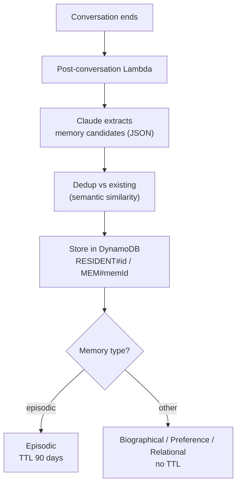

# Access For Seniors — Memory Capture

## Memory Types

| Type | Definition | TTL | Example |
|------|-----------|-----|---------|
| Biographical | Stable life facts | None | "Was a teacher for 30 years" |
| Preference | Likes/dislikes, communication style | None | "Loves jazz, especially Miles Davis" |
| Episodic | Recent events, things mentioned | 90 days | "Granddaughter visited last Tuesday" |
| Relational | People who matter and their significance | None | "Daughter Sarah in Denver, calls weekly" |

## Extraction Pipeline



## Extraction Prompt

```
Given this conversation, extract any new facts about the resident.
Return JSON array of memory items:
[
  { "type": "biographical|preference|episodic|relational", "content": "..." , "confidence": 0.0-1.0 }
]
Only extract facts clearly stated or strongly implied. Do not infer emotions or diagnoses.
If no new facts, return empty array.
```

## Conflict Resolution

- If new memory contradicts existing: keep both, flag for caregiver review
- Caregiver can mark memories as "confirmed", "disputed", or "deleted"
- Deleted memories are soft-deleted (audit trail retained)
