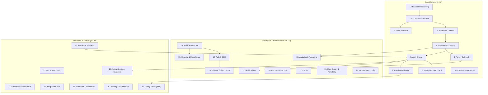

# Access For Seniors Enterprise — Module Reference

## Table of Contents
1. [Module 1–10: Core Platform](#core-platform-modules-1-10)
2. [Module 11–20: Enterprise & Infrastructure](#enterprise--infrastructure-modules-11-20)
3. [Module 21–28: Advanced & Growth](#advanced--growth-modules-21-28)

## Module map

---

## Core Platform Modules (1–10)

### Module 1: Resident Onboarding
- **Purpose:** Intake form, consent capture, profile setup
- **Roles:** Facility Admin, Caregiver
- **Key flows:** Create resident → capture consent → build interest profile → assign caregiver(s) → activate AI
- **Data:** `Resident` record (PK: `TENANT#<tenantId>`, SK: `RESIDENT#<residentId>`)
- **Consent types:** AI conversation, data sharing with family, voice recording, photo use
- **Edge cases:** Resident lacks capacity (guardian consent required), resident declines AI but accepts human check-ins

### Module 2: AI Conversation Core
- **Purpose:** Base conversation engine powered by Anthropic Claude API
- **Reference:** `conversation-engine.md`
- **Key capabilities:** Multi-turn conversation, memory injection, topic steering, safety guardrails
- **Prompt architecture:** System prompt (persona + safety) → memory context → conversation history → user turn
- **Safety:** Content filter on all outputs, escalation to human on distress signals, no medical/legal advice
- **Metrics:** Turns per session, session duration, topic diversity, resident satisfaction (implicit + explicit)

### Module 3: Memory & Context
- **Purpose:** Persistent resident context across conversations
- **Reference:** `memory-capture.md`
- **How it works:** Post-conversation extraction → structured memory items → injected into next session's context
- **Memory types:** Biographical (static), preference (semi-static), episodic (dynamic), relational (who matters to them)
- **Storage:** DynamoDB with TTL for episodic items; S3 for raw conversation logs
- **Privacy:** Memory items are PHI — encrypted at rest, access-logged, deletable on request

### Module 4: Engagement Scoring
- **Purpose:** Loneliness and social isolation risk detection
- **Reference:** `engagement-scoring.md`
- **Signal sources:** Conversation frequency, conversation quality (depth, emotional valence), activity participation, family contact frequency, caregiver observations
- **Score output:** 0–100 engagement index; thresholds: Green (70+), Yellow (40–69), Red (<40)
- **Clinical framing:** Scores are "connection signals" — never diagnoses. Language: "shows reduced engagement" not "is lonely"
- **Update cadence:** Daily recalculation; 7-day and 30-day trend lines

### Module 5: Alert Engine
- **Purpose:** Threshold-based alerts with routing to appropriate responders
- **Reference:** `alerts-system.md`
- **Trigger types:** Score drop below threshold, distress keyword detected, missed check-in streak, family-requested wellness check
- **Routing:** Alert → (Caregiver AND/OR Family) based on tenant config and alert severity
- **Escalation:** Tier 1 (caregiver notification) → Tier 2 (supervisor + family) → Tier 3 (facility admin + emergency contact)
- **Delivery:** Push notification, SMS, email, dashboard badge — configurable per tenant

### Module 6: Caregiver Dashboard
- **Purpose:** Web-based staff interface for monitoring and documenting
- **Reference:** `caregiver-dashboard.md`
- **Key views:** Resident list (sortable by engagement score), individual resident detail, alert inbox, shift notes, reporting
- **Tech:** React 18 + Vite + TypeScript, Clerk auth, Tailwind CSS
- **Real-time:** WebSocket or polling for live alert badges
- **Accessibility:** WCAG 2.1 AA compliance target

### Module 7: Family Mobile App
- **Purpose:** iOS/Android app for family members
- **Reference:** `mobile-app.md`
- **Key screens:** Home (connection status), resident profile, connection history (themes, not transcripts), send a message prompt, notification inbox
- **Tech:** React Native + Expo, Clerk Expo SDK, biometric login
- **Privacy:** Family sees engagement trends and conversation themes — never raw transcripts or AI scores
- **Offline:** Read-only cache of last resident summary (AsyncStorage, 24h TTL)

### Module 8: Voice Interface
- **Purpose:** Phone/voice-based conversation for residents who prefer talking
- **Reference:** `voice-interface.md`
- **Tech:** Twilio Voice + ElevenLabs STT/TTS (or AWS Transcribe + Polly) + Claude API
- **Flow:** Resident calls → voice greeting → real-time STT → Claude generates response → TTS playback
- **Safety:** Same content filters as text; distress detection triggers caregiver alert
- **Recording:** Configurable per tenant; if enabled, stored encrypted in S3 with consent flag

### Module 9: Family Outreach
- **Purpose:** AI-generated messaging to encourage family connection
- **Reference:** `family-outreach.md` + `message-generator.md`
- **Message types:** Connection reminder, conversation highlight (anonymized), activity suggestion, milestone celebration
- **Tone:** Warm, never guilt-inducing, never clinical — "Mom mentioned she enjoyed gardening this week" not "Your mother's loneliness score dropped"
- **Delivery:** Push notification, email, SMS — family preference controls
- **Frequency:** Configurable; default 1–2 per week; never spam

### Module 10: Community Features
- **Purpose:** Group activities, interest matching, shared social spaces
- **Reference:** `community-features.md`
- **Capabilities:** Interest-based group matching, activity calendar, group conversation facilitation, photo sharing (with consent)
- **Privacy:** Group interactions are opt-in; residents can leave any group; no cross-group data leakage
- **Staff tools:** Activity scheduling, attendance tracking, group engagement reports

---

## Enterprise & Infrastructure Modules (11–20)

### Module 11: Notifications
- **Purpose:** Multi-channel delivery engine
- **Reference:** `notifications.md`
- **Channels:** Push (Expo/APNs/FCM), SMS (Pinpoint/Twilio), Email (SES), In-app badge
- **Preferences:** Per-user channel + frequency preferences; quiet hours; do-not-disturb
- **Templates:** Handlebars-based templates with localization support

### Module 12: Analytics & Reporting
- **Purpose:** Facility-level and enterprise-level dashboards
- **Reference:** `analytics.md`
- **Resident-level:** Engagement trend, conversation frequency, alert history, family contact log
- **Facility-level:** Aggregate engagement scores, alert volume, staff response time, family engagement rate
- **Enterprise-level:** Cross-facility benchmarking, trend analysis, ROI metrics
- **Export:** CSV, PDF (scheduled or on-demand)
- **Data pipeline:** DynamoDB streams → Lambda → RDS Aurora (analytics warehouse)

### Module 13: Multi-Tenant Core
- **Purpose:** Tenant isolation, configuration, and provisioning
- **Reference:** `multi-tenant.md`
- **Isolation model:** DynamoDB: `tenantId` in every PK; RDS: row-level security; S3: prefix-based
- **Provisioning:** `POST /internal/tenants` → DynamoDB record + Stripe customer + Cognito pool
- **Config:** Per-tenant settings for alerts, notifications, consent, branding, data retention
- **Tenant types:** Single facility, multi-facility org, enterprise (health system)

### Module 14: Auth & SSO
- **Purpose:** Authentication for all user types
- **Reference:** `auth.md`
- **Staff/Consumer web:** Clerk (`@clerk/react`) with email, Google, Microsoft SSO
- **Enterprise/SAML:** Amazon Cognito with SAML 2.0 / OIDC federation
- **Mobile:** Clerk Expo SDK with biometric login
- **JWT validation:** Every API call validated; tenant context extracted from token claims
- **MFA:** Enforced for admin roles; optional for family members

### Module 15: Billing & Subscriptions
- **Purpose:** Stripe-powered billing for B2B SaaS
- **Reference:** `billing.md`
- **Models:** Per-resident/month (volume tiers), per-facility flat rate, enterprise custom
- **Stripe objects:** Product → Price → Subscription → Invoice → Usage Record (metered)
- **Webhook handling:** `invoice.paid`, `customer.subscription.updated`, `customer.subscription.deleted`
- **Dunning:** Automated retry + email sequence on failed payment
- **Self-serve:** Admin can view invoices, update payment method, change plan

### Module 16: AWS Infrastructure
- **Purpose:** All cloud resources defined as CDK (TypeScript)
- **Reference:** `aws-deployment.md`
- **Stacks:** API (Lambda/API Gateway), Data (DynamoDB + RDS), Auth (Cognito), Storage (S3), Messaging (SES/SNS/Pinpoint), Monitoring (CloudWatch + alarms)
- **Environments:** dev, staging, prod — isolated AWS accounts preferred
- **IAM:** Least-privilege per Lambda; no wildcard policies; service-linked roles
- **Secrets:** SSM SecureString for API keys, DB creds, Stripe keys

### Module 17: CI/CD
- **Purpose:** Automated test, build, deploy pipeline
- **Reference:** `cicd.md`
- **Pipeline:** PR → lint + typecheck + unit tests → merge to main → CDK deploy to staging → manual approval → prod
- **GitHub Actions:** Reusable workflows for test, build, deploy
- **Rollback:** CDK stack rollback on failure; Lambda versioning with aliases

### Module 18: Security & Compliance
- **Purpose:** HIPAA-aligned security controls
- **Reference:** `security.md`
- **Encryption:** KMS for DynamoDB/RDS/S3; TLS 1.2+ in transit
- **Audit:** CloudTrail (API-level), application audit log (data access), Clerk audit log (auth events)
- **Access control:** RBAC with roles: Resident, Family, Caregiver, Admin, Operator
- **BAA:** Required with AWS, Stripe, Anthropic, Twilio, ElevenLabs, Clerk
- **Incident response:** Documented runbook; 72-hour breach notification
- **Penetration testing:** Annual; automated SAST/DAST in CI

### Module 19: Data Export & Portability
- **Purpose:** Resident/family right to data access and portability
- **Capabilities:** Export resident profile + conversation themes + engagement history as PDF/CSV
- **Deletion:** Right to deletion with audit trail of request
- **Compliance:** HIPAA right of access (45 days), state privacy laws
- **Admin tools:** Bulk export for facility transitions

### Module 20: White-Label Config
- **Purpose:** Per-tenant branding and customization
- **Config options:** Logo, color palette, facility name, welcome message, AI persona name
- **Storage:** Tenant config in DynamoDB; logo/assets in S3
- **Scope:** Dashboard, mobile app, email templates, SMS sender name

---

## Advanced & Growth Modules (21–28)

### Module 21: Enterprise Admin Portal
- **Purpose:** Multi-site operator console for health systems and large organizations
- **Capabilities:** Cross-facility dashboards, user management, billing overview, compliance reporting
- **Auth:** Cognito with SAML federation to enterprise IdP
- **Data:** Aggregated across tenant hierarchy (org → region → facility)

### Module 22: API & MCP Tools
- **Purpose:** External API for integrations + MCP server for Claude AI
- **Reference:** `mcp-tools.md`
- **REST API:** CRUD for residents, conversations, alerts, reports — API key + JWT auth
- **MCP server:** Tool schemas for `get_resident`, `log_interaction`, `get_engagement_score`, `send_alert`, `generate_outreach_message`
- **Rate limiting:** Per-tenant, per-endpoint

### Module 23: Integrations Hub
- **Purpose:** Connect to external systems (EHR, care platforms)
- **Target integrations:** PointClickCare, MatrixCare, Epic (FHIR), CareSmartz360
- **Pattern:** Webhook-based sync with retry + dead-letter queue
- **Data mapping:** Resident demographics, care plans, medication lists (read-only)

### Module 24: Research & Outcomes
- **Purpose:** Anonymized data for academic research partnerships
- **De-identification:** HIPAA Safe Harbor method; k-anonymity checks
- **IRB support:** Data use agreement templates, consent addendum for research participation
- **Outputs:** Aggregate engagement trends, intervention efficacy data, loneliness prevalence

### Module 25: Training & Certification
- **Purpose:** Staff training on platform use and senior engagement best practices
- **Content:** Video tutorials, interactive guides, knowledge checks
- **Certification:** Completion tracking per staff member; compliance with facility training requirements
- **Delivery:** In-app (dashboard embedded) or LMS integration (SCORM)

### Module 26: Family Portal (Web)
- **Purpose:** Web-based alternative to mobile app for family members
- **Capabilities:** Same as Module 7 but browser-based; additional features like video call scheduling
- **Tech:** React 18 + Vite + Clerk; responsive design for tablet/desktop
- **Accessibility:** WCAG 2.1 AA; large text mode; high contrast mode

### Module 27: Predictive Wellness
- **Purpose:** ML-based prediction of engagement decline before it happens
- **Approach:** Time-series analysis of engagement scores + conversation sentiment + activity participation
- **Output:** "Predicted decline in 7–14 days" flag on caregiver dashboard
- **Ethics:** Predictions are advisory; never override caregiver judgment; transparent methodology
- **Privacy:** Model runs on aggregated/anonymized features; individual predictions stored as PHI

### Module 28: Aging-Services Navigation
- **Purpose:** Connect residents and families to external aging-services programs (OAA, Medicare, Medicaid, AAA)
- **Reference:** `aging-services.md`
- **Capabilities:** Needs screening, program matching, eligibility walkthrough, warm referral to AAA, referral tracking
- **Key programs supported:** OAA Title III-B/C/D/E/VII, Medicare Parts A–D, Medicaid LTSS, Meals on Wheels, SNAP, LIHEAP, caregiver respite
- **Integration:** Uses MCP `log_interaction` tool to document referrals; caregiver dashboard shows referral status
- **Data:** ReferralRecord entity — tracks program, eligibility status, application date, outcome
- **Privacy:** Eligibility data (income, household size) is PHI-adjacent; same encryption and access controls apply
