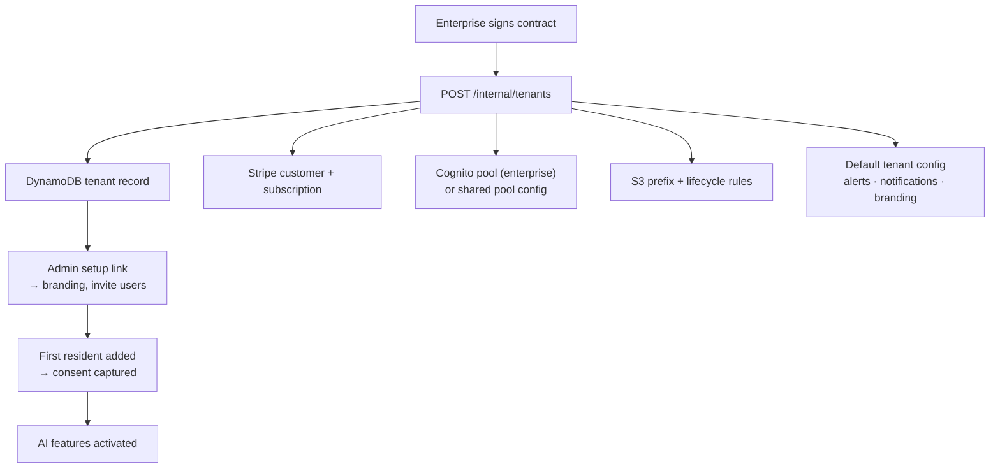
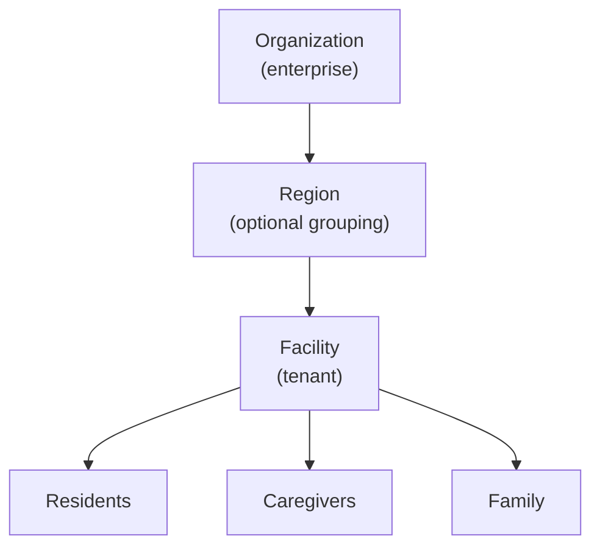

# Access For Seniors — Multi-Tenant Architecture

## Isolation Model

| Layer | Strategy |
|-------|----------|
| DynamoDB | `tenantId` in every partition key; queries always scoped |
| RDS Aurora | Row-level security policies; `tenant_id` column on every table |
| S3 | Prefix-based: `s3://bucket/{tenantId}/...`; bucket policy enforces prefix |
| Cognito | Enterprise tenants get dedicated user pool; shared pool uses custom attributes |
| API Gateway | Lambda authorizer extracts tenantId from JWT; injects into every downstream call |

## Tenant Provisioning Flow



## Tenant Hierarchy



- Single-facility tenants: Organization = Facility
- Multi-facility: Organization has N facilities, each a separate tenant with shared billing
- Enterprise operators see aggregated data across their tenant hierarchy

## Config Inheritance

Facility config overrides organization defaults. Explicit `null` in facility config falls back to org default.

```typescript
function resolveConfig(orgConfig: TenantConfig, facilityConfig: Partial<TenantConfig>): TenantConfig {
  return deepMerge(orgConfig, facilityConfig);
}
```
