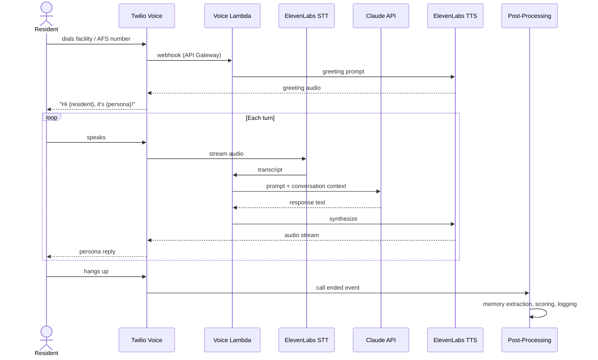

# Access For Seniors — Voice Interface

## Architecture

## Voice Persona

- ElevenLabs voice cloned or selected from library
- Configurable per tenant (voice, speaking rate, warmth)
- Default: warm, medium pace, American English

## Safety

- Same content and distress filters as text conversation
- Voice distress detection: keywords + tone analysis (if available)
- Call recording: configurable per tenant; consent prompt at start if enabled
- Max call duration: 30 minutes (configurable); gentle close at limit

## Accessibility

- Support for hearing-impaired: real-time transcript option (WebSocket to family/caregiver app)
- Support for speech difficulties: patience parameters in Claude prompt; longer silence thresholds
